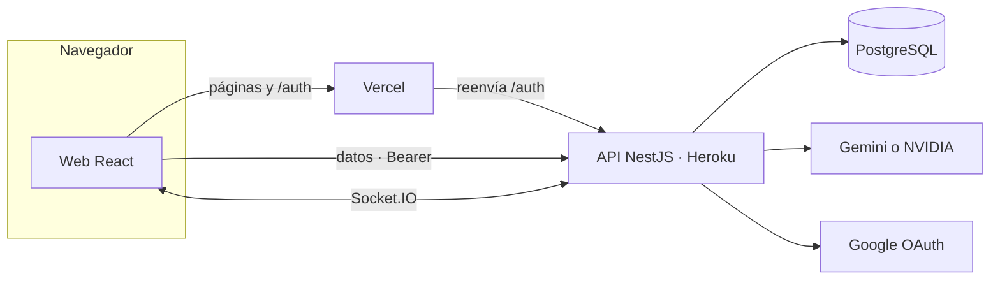
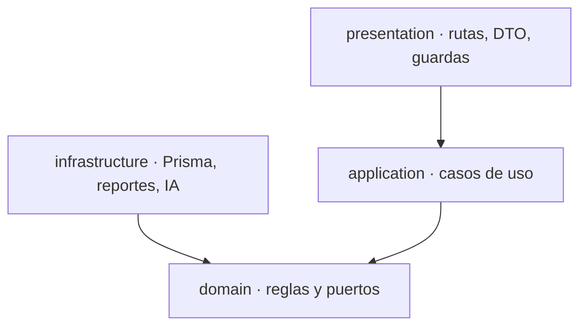
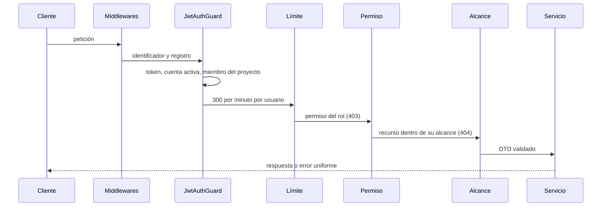
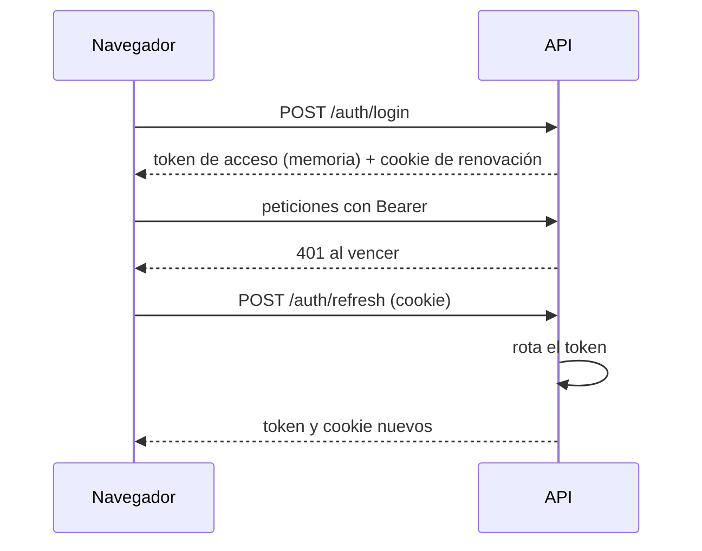
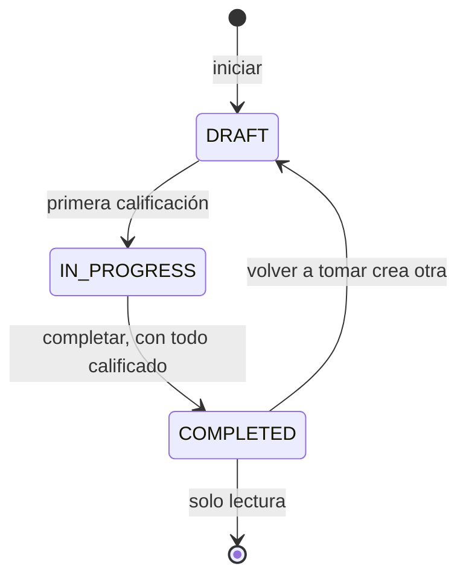

# Arquitectura

## Qué es

Evalúa diagnostica organizaciones (asociaciones de productores y empresas) con
tres herramientas: Organizativa (73 KPI en 6 dimensiones), Capacidades (30 KPI en
4 áreas) y Riesgos (46 KPI en 4 principios). De cada evaluación salen un puntaje,
los KPI críticos, un plan de mejora y un reporte.

## Piezas



## Qué utiliza

| Para | Servidor | Web |
|---|---|---|
| Base | Node 20 o más, TypeScript, NestJS 10 | React 18, TypeScript, Vite 7 |
| Datos | Prisma 5 y PostgreSQL | TanStack Query |
| Rutas | Controladores de Nest | TanStack Router, por archivos |
| Validación | class-validator | Formularios propios |
| Sesión | JWT, bcrypt, cookies HttpOnly | Token en memoria |
| Tiempo real | Socket.IO | socket.io-client |
| Reportes | pptxgenjs y ExcelJS | |
| Interfaz | | Tailwind, Radix, lucide, recharts |
| Sin conexión | | IndexedDB (idb-keyval) |
| Protección | helmet, throttler | CSP en `vercel.json` |
| Pruebas | Jest, Supertest, Stryker | Vitest, Testing Library, Stryker |

## Capas

Cada módulo de `src/modules` sigue la misma división. Las dependencias apuntan
hacia adentro: el dominio no conoce a nadie.



- **domain**: reglas puras, tipos y *puertos* (interfaces de lo que necesita de
  afuera). Sin NestJS ni Prisma.
- **application**: casos de uso. Reciben los puertos inyectados.
- **infrastructure**: adaptadores que cumplen los puertos.
- **presentation**: controladores, DTO y guardas.

Los módulos de identidad y núcleo usan `PrismaService` directo en sus casos de
uso; los puertos se aplican donde cambiar la implementación tiene sentido
(herramientas, analítica, IA, cifrado, tokens y OAuth).

## Módulos

| Módulo | Responsabilidad | Depende de |
|---|---|---|
| `identity` | Sesión, usuarios, proyectos, autorización. Global | `shared` |
| `audit` | Auditoría y su retención | `shared` |
| `assessment-core` | Organizaciones evaluadas, roles, alcance, aplicabilidad, panel, plan consolidado, puntuación y plantillas base | `identity`, `audit` |
| `assessment-session` | Sala en vivo por evaluación | `identity` |
| `assessment-ai` | Proveedor de IA, caché y corte por fallos | `shared` |
| `evaluation-tool` | Motor común de las herramientas | `assessment-core`, `assessment-ai`, `assessment-session` |
| `organizational-tool`, `capacity-tool` | Configuran el motor común | `evaluation-tool` |
| `risk-tool` | Amplía el motor con riesgos y mitigación | `evaluation-tool` |
| `assessment-analytics` | Estadística sobre el conjunto | `assessment-core` |
| `shared` | Base de datos, configuración, HTTP, registros, reportes y paginación | |

## Patrones

| Patrón | Dónde | Para qué |
|---|---|---|
| Template Method | `EvaluationToolService` → `IndicatorMeasureToolService` / `RiskToolService` | Un solo flujo de evaluación; cada herramienta redefine solo lo que cambia |
| Strategy | `ToolScoringStrategy`, `AiProvider`, `OAuthVerifierPort` | Intercambiar el cálculo, el proveedor de IA o el de acceso |
| Factory | `createAiProviderFromEnv`, `createIndicatorToolController` | Elegir el proveedor; generar las rutas de una herramienta |
| Puertos y adaptadores | Repositorios, `AnalyticsDataset`, `PasswordHasherPort`, `TokenIssuerPort` | Probar sin base, red ni criptografía |
| Circuit breaker | `LlmCircuitBreaker` | Dejar de llamar a una IA caída |
| Semáforo | `withExportSlot` | Que los reportes no agoten el servidor |
| Copia al escribir | `cloneAsNewVersion` | Plantillas inmutables una vez usadas |

## Recorrido de una petición



Toda respuesta de error tiene la misma forma:
`{ statusCode, message, requestId, timestamp, path }`. En producción un 500 no
muestra detalles; con el `requestId` se encuentran en los registros.

## Sesión



- El token de acceso nunca toca `localStorage`. La cookie es HttpOnly, Secure y
  con ruta `/auth`.
- Cada renovación revoca el token usado. Reusar uno viejo revoca toda la familia.
- Hay 30 segundos de margen para pestañas simultáneas, solo si la sesión sigue
  abierta. La web además las turna con Web Locks.
- Los permisos se leen de la base en cada petición, no del token.

## Tiempo real

Espacio `/assessments`. El cliente conecta con su token, envía
`join { org, evaluationId }` y entra a la sala `eval:<id>` si tiene acceso. Al
guardar una calificación el servidor emite
`score.updated { evaluationId, indicatorIds, scoredBy }`. Un fallo del aviso nunca
afecta el guardado.

## Flujo de una evaluación



## Tareas programadas

`AuditRetentionService` corre cada día a las 03:00 del servidor (UTC en
Heroku, 22:00 en Ecuador): borra la auditoría de más de
24 meses (`ACTIVITY_LOG_RETENTION_MONTHS`) y los tokens de renovación vencidos.

## Carpetas

```text
src/
  main.ts                 arranque: helmet, CORS, errores, Socket.IO, Swagger
  app.module.ts           módulos, límites y middlewares
  modules/<módulo>/       domain, application, infrastructure, presentation
  shared/                 base de datos, configuración, HTTP, registros, reportes
prisma/
  schema.prisma           modelo
  migrations/             cambios publicados: no se editan
  seeds/                  datos iniciales, demostración y producción
test/                     pruebas de integración
scripts/                  carga, tiempo del reporte, vigilancia y comentarios
```
