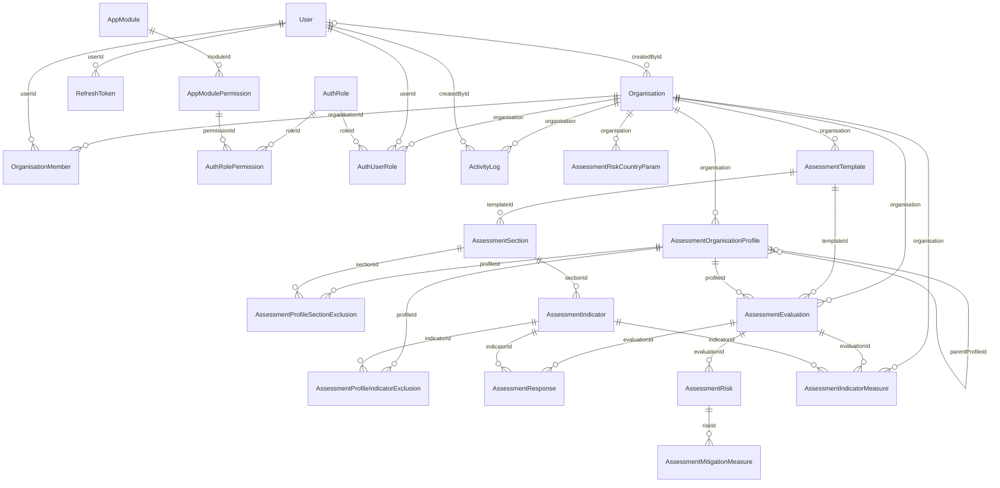

# Base de datos

PostgreSQL con Prisma 5. El modelo está en `prisma/schema.prisma` y tiene 23 tablas.

## Diagrama



## Convenciones

- **Inquilino.** Los datos de evaluación llevan `organisation`, el proyecto dueño.
  Toda consulta filtra por él.
- **Claves.** `cuid` como texto, salvo `Organisation` (un texto legible) y
  `AssessmentAiCache` (un sha256).
- **Borrado lógico.** `deletedAt` con fecha significa borrado. No hay un filtro
  automático: cada consulta agrega `deletedAt: null`.
- **Fechas de calendario** (inicio y fin de medidas): medianoche UTC. La web toma
  solo año, mes y día.
- **Decimales.** Pesos y puntajes son `Decimal`; la API los entrega como texto.
- **Nombres únicos con borrado lógico.** Los índices únicos no excluyen los
  borrados: por eso se revive la fila con `upsert` en lugar de crear otra.

## Enumeraciones

| Enumeración | Valores |
|---|---|
| `AssessmentTool` | `ORGANIZATIONAL`, `CAPACITY`, `RISK` |
| `AssessmentEvaluationStatus` | `DRAFT`, `IN_PROGRESS`, `COMPLETED`, `ARCHIVED` |
| `AssessmentRiskClass` | `NEGLIGIBLE`, `NON_NEGLIGIBLE` |
| `AssessmentMeasureStatus` | `PENDING`, `IN_PROGRESS`, `DONE` |

## Tablas

### Identidad y acceso

#### `Organisation`

**Proyecto.** Es el inquilino: separa por completo los datos de cada cliente. El `id` es un texto legible que viaja en las direcciones y no cambia.

| Columna | Tipo | Obligatoria | Por defecto | Descripción |
|---|---|---|---|---|
| `id` | texto | sí |  | Clave primaria. Slug legible, p.ej. "demo" — se usa como `:org` en las rutas |
| `createdAt` | fecha y hora | sí | ahora | Cuándo se creó |
| `updatedAt` | fecha y hora | sí |  | Último cambio |
| `deletedAt` | fecha y hora | no |  | Borrado lógico: con fecha, está borrado |
| `name` | texto | sí |  | Nombre |
| `createdById` | texto | no |  | Superadministrador que lo creó: solo él tiene acceso total → `User` (queda nulo si se borra) |

Índices: `(createdById)`.

#### `User`

Cuenta de una persona, independiente de los proyectos.

| Columna | Tipo | Obligatoria | Por defecto | Descripción |
|---|---|---|---|---|
| `id` | texto | sí | cuid | Clave primaria. Identificador |
| `createdAt` | fecha y hora | sí | ahora | Cuándo se creó |
| `updatedAt` | fecha y hora | sí |  | Último cambio |
| `deletedAt` | fecha y hora | no |  | Borrado lógico: con fecha, está borrado |
| `email` | texto | sí |  | Correo, en minúsculas. Único |
| `passwordHash` | texto | no |  | Null cuando el usuario solo entra por OAuth |
| `name` | texto | no |  | Nombre |
| `isSuperAdmin` | sí/no | sí | false | Superadministrador de la plataforma |
| `isActive` | sí/no | sí | true | En falso no puede entrar y pierde el acceso al momento |
| `oauthProvider` | texto | no |  | Proveedor externo (google) |
| `oauthSubject` | texto | no |  | Identificador en ese proveedor |

Único: `(oauthProvider, oauthSubject)`.

#### `RefreshToken`

Sesiones. Cada renovación revoca el token usado y crea otro de la misma familia.

| Columna | Tipo | Obligatoria | Por defecto | Descripción |
|---|---|---|---|---|
| `id` | texto | sí | cuid | Clave primaria. Identificador |
| `createdAt` | fecha y hora | sí | ahora | Cuándo se creó |
| `userId` | texto | sí |  | Usuario → `User` (se borra con él) |
| `tokenHash` | texto | sí |  | Sha256 del token; el valor real solo está en la cookie. Único |
| `familyId` | texto | sí |  | Cadena de rotaciones de una misma sesión |
| `expiresAt` | fecha y hora | sí |  | Vencimiento |
| `revokedAt` | fecha y hora | no |  | Cuándo se rotó o se revocó |
| `userAgent` | texto | no |  | Navegador |

Índices: `(userId)`; `(familyId)`.

#### `OrganisationMember`

A qué proyectos pertenece cada usuario.

| Columna | Tipo | Obligatoria | Por defecto | Descripción |
|---|---|---|---|---|
| `id` | texto | sí | cuid | Clave primaria. Identificador |
| `createdAt` | fecha y hora | sí | ahora | Cuándo se creó |
| `organisationId` | texto | sí |  | Proyecto → `Organisation` (se borra con él) |
| `userId` | texto | sí |  | Usuario → `User` (se borra con él) |

Único: `(organisationId, userId)`.
Índices: `(userId)`.

#### `AppModule`

Módulos sobre los que se dan permisos.

| Columna | Tipo | Obligatoria | Por defecto | Descripción |
|---|---|---|---|---|
| `id` | texto | sí | cuid | Clave primaria. Identificador |
| `createdAt` | fecha y hora | sí | ahora | Cuándo se creó |
| `updatedAt` | fecha y hora | sí |  | Último cambio |
| `deletedAt` | fecha y hora | no |  | Borrado lógico: con fecha, está borrado |
| `code` | texto | sí |  | "assessment-core", "organizational-tool", .... Único |
| `name` | texto | sí |  | Nombre |
| `description` | texto | no |  | Descripción |
| `sortOrder` | entero | sí | 0 | Orden |
| `isActive` | sí/no | sí | true | Activo |

Índices: `(code)`.

#### `AppModulePermission`

Acciones de cada módulo: read, write, delete, admin.

| Columna | Tipo | Obligatoria | Por defecto | Descripción |
|---|---|---|---|---|
| `id` | texto | sí | cuid | Clave primaria. Identificador |
| `createdAt` | fecha y hora | sí | ahora | Cuándo se creó |
| `updatedAt` | fecha y hora | sí |  | Último cambio |
| `deletedAt` | fecha y hora | no |  | Borrado lógico: con fecha, está borrado |
| `moduleId` | texto | sí |  | Módulo de permisos → `AppModule` |
| `code` | texto | sí |  | "read", "write", "delete", "admin" |
| `name` | texto | sí |  | Nombre |
| `description` | texto | no |  | Descripción |

Único: `(moduleId, code)`.
Índices: `(moduleId)`.

#### `AuthRole`

Roles: `assessment_admin`, `assessment_evaluator` y `assessment_viewer`.

| Columna | Tipo | Obligatoria | Por defecto | Descripción |
|---|---|---|---|---|
| `id` | texto | sí | cuid | Clave primaria. Identificador |
| `organisation` | texto | no |  | Nulo en los roles de sistema |
| `createdAt` | fecha y hora | sí | ahora | Cuándo se creó |
| `updatedAt` | fecha y hora | sí |  | Último cambio |
| `deletedAt` | fecha y hora | no |  | Borrado lógico: con fecha, está borrado |
| `code` | texto | sí |  | Código |
| `name` | texto | sí |  | Nombre |
| `description` | texto | no |  | Descripción |
| `isSystem` | sí/no | sí | false | Rol de sistema |
| `sortOrder` | entero | sí | 0 | Orden |

Único: `(organisation, code)`.
Índices: `(organisation)`; `(code)`.

#### `AuthRolePermission`

Qué permisos tiene cada rol.

| Columna | Tipo | Obligatoria | Por defecto | Descripción |
|---|---|---|---|---|
| `id` | texto | sí | cuid | Clave primaria. Identificador |
| `createdAt` | fecha y hora | sí | ahora | Cuándo se creó |
| `roleId` | texto | sí |  | Rol → `AuthRole` (se borra con él) |
| `permissionId` | texto | sí |  | Permiso → `AppModulePermission` (se borra con él) |
| `grantedBy` | texto | no |  | Quién lo otorgó |

Único: `(roleId, permissionId)`.
Índices: `(roleId)`; `(permissionId)`.

#### `AuthUserRole`

Qué rol tiene cada usuario en cada proyecto.

| Columna | Tipo | Obligatoria | Por defecto | Descripción |
|---|---|---|---|---|
| `id` | texto | sí | cuid | Clave primaria. Identificador |
| `organisation` | texto | sí |  | Proyecto dueño del dato → `Organisation` (se borra con él) |
| `createdAt` | fecha y hora | sí | ahora | Cuándo se creó |
| `updatedAt` | fecha y hora | sí |  | Último cambio |
| `deletedAt` | fecha y hora | no |  | Revocación del rol |
| `userId` | texto | sí |  | Usuario → `User` (se borra con él) |
| `roleId` | texto | sí |  | Rol → `AuthRole` (se borra con él) |
| `assignedBy` | texto | no |  | Quién lo asignó |
| `customPermissions` | JSON | no |  | En el visualizador, qué organizaciones ve: `{ allProfiles, profileIds }` |

Único: `(organisation, userId, roleId)`.
Índices: `(organisation)`; `(userId)`; `(roleId)`.


### Auditoría

#### `ActivityLog`

Auditoría. Se conserva 24 meses.

| Columna | Tipo | Obligatoria | Por defecto | Descripción |
|---|---|---|---|---|
| `id` | texto | sí | cuid | Clave primaria. Identificador |
| `createdAt` | fecha y hora | sí | ahora | Cuándo se creó |
| `organisation` | texto | sí |  | Proyecto → `Organisation` (se borra con él) |
| `createdById` | texto | sí |  | Usuario que lo creó → `User` |
| `type` | texto | sí |  | P.ej. "assessment-evaluation.complete" |
| `note` | texto | sí |  | Texto del registro |
| `level` | texto | sí | "INFO" | INFO / WARNING / ERROR / DEBUG |
| `sourceType` | texto | sí | "UI" | Origen de la acción |
| `dataPreview` | JSON | sí |  | Resumen del detalle |
| `data` | JSON | sí |  | Detalle de la acción |
| `ipAddress` | texto | no |  | IP |
| `userAgent` | texto | no |  | Navegador |
| `requestId` | texto | no |  | Petición, para cruzar con los registros |

Índices: `(organisation, type, createdAt)`; `(organisation, level, createdAt)`; `(createdAt)`.


### Organizaciones evaluadas

#### `AssessmentOrganisationProfile`

**Organización evaluada**: una asociación o una empresa. El nombre es único en el proyecto.

| Columna | Tipo | Obligatoria | Por defecto | Descripción |
|---|---|---|---|---|
| `id` | texto | sí | cuid | Clave primaria. Identificador |
| `createdAt` | fecha y hora | sí | ahora | Cuándo se creó |
| `updatedAt` | fecha y hora | sí |  | Último cambio |
| `deletedAt` | fecha y hora | no |  | Borrado lógico: con fecha, está borrado |
| `organisation` | texto | sí |  | Organización dueña del dato → `Organisation` |
| `name` | texto | sí |  | Nombre |
| `tradeName` | texto | no |  | Nombre comercial |
| `type` | texto | sí |  | "ASSOCIATION" / "COMPANY" |
| `associationLevel` | texto | no |  | LEVEL_1 o LEVEL_2, solo en asociaciones |
| `country` | texto | sí |  | Determina parámetros de riesgo en Risk |
| `region` | texto | no |  | Región o provincia |
| `yearStarted` | entero | no |  | Año de inicio de actividades |
| `memberCount` | entero | no |  | Número de socios |
| `mainActivity` | texto | no |  | Actividad principal (p.ej. "Exportación de cacao...") |
| `mainProduct` | texto | sí |  | "cacao" / "café" / otro |
| `secondaryProducts` | texto | no |  | Otros productos (opcional) |
| `certifications` | texto | no |  | Certificaciones |
| `mainMarkets` | texto | no |  | Principales mercados |
| `legalRep` | texto | no |  | Representante legal |
| `contactEmail` | texto | no |  | Correo de contacto |
| `contactPhone` | texto | no |  | `+prefijo número`, con los dígitos de su país |
| `evaluatorId` | texto | no |  | Evaluador responsable asignado |
| `confidential` | sí/no | sí | false | Excluye este perfil de la vista cross-organización del Administrador |
| `parentProfileId` | texto | no |  | Asociación de nivel 2 a la que pertenece → `AssessmentOrganisationProfile` |

Único: `(organisation, name)`.
Índices: `(organisation)`; `(evaluatorId)`; `(parentProfileId)`.

#### `AssessmentProfileSectionExclusion`

Secciones que no aplican a una organización.

| Columna | Tipo | Obligatoria | Por defecto | Descripción |
|---|---|---|---|---|
| `id` | texto | sí | cuid | Clave primaria. Identificador |
| `createdAt` | fecha y hora | sí | ahora | Cuándo se creó |
| `createdBy` | texto | sí |  | Quién lo creó |
| `profileId` | texto | sí |  | Organización evaluada → `AssessmentOrganisationProfile` (se borra con él) |
| `sectionId` | texto | sí |  | Sección → `AssessmentSection` (se borra con él) |

Único: `(profileId, sectionId)`.
Índices: `(profileId)`.

#### `AssessmentProfileIndicatorExclusion`

KPI que no aplican a una organización.

| Columna | Tipo | Obligatoria | Por defecto | Descripción |
|---|---|---|---|---|
| `id` | texto | sí | cuid | Clave primaria. Identificador |
| `createdAt` | fecha y hora | sí | ahora | Cuándo se creó |
| `createdBy` | texto | sí |  | Quién lo creó |
| `profileId` | texto | sí |  | Organización evaluada → `AssessmentOrganisationProfile` (se borra con él) |
| `indicatorId` | texto | sí |  | KPI → `AssessmentIndicator` (se borra con él) |

Único: `(profileId, indicatorId)`.
Índices: `(profileId)`.

#### `AssessmentRiskCountryParam`

Umbral de riesgo despreciable por país.

| Columna | Tipo | Obligatoria | Por defecto | Descripción |
|---|---|---|---|---|
| `id` | texto | sí | cuid | Clave primaria. Identificador |
| `createdAt` | fecha y hora | sí | ahora | Cuándo se creó |
| `updatedAt` | fecha y hora | sí |  | Último cambio |
| `organisation` | texto | sí |  | Proyecto dueño del dato → `Organisation` |
| `country` | texto | sí |  | ISO 3166-1 alpha-2, p.ej. "EC" |
| `riskThreshold` | decimal | sí |  | Umbral de ese país |
| `updatedBy` | texto | no |  | Quién lo cambió por última vez |

Único: `(organisation, country)`.


### Herramientas

#### `AssessmentTemplate`

Estructura de una herramienta en un proyecto. Cada cambio sobre una versión ya usada crea otra.

| Columna | Tipo | Obligatoria | Por defecto | Descripción |
|---|---|---|---|---|
| `id` | texto | sí | cuid | Clave primaria. Identificador |
| `createdAt` | fecha y hora | sí | ahora | Cuándo se creó |
| `updatedAt` | fecha y hora | sí |  | Último cambio |
| `deletedAt` | fecha y hora | no |  | Borrado lógico: con fecha, está borrado |
| `organisation` | texto | sí |  | Proyecto dueño del dato → `Organisation` |
| `tool` | `AssessmentTool` | sí |  | Herramienta |
| `version` | entero | sí | 1 | Versión, desde 1 |
| `name` | texto | sí |  | Nombre |
| `description` | texto | no |  | Descripción |
| `active` | sí/no | sí | true | Solo una vigente por herramienta y proyecto |
| `labels` | JSON | no |  | Textos en otros idiomas |
| `createdBy` | texto | no |  | Quién lo creó |
| `riskThreshold` | decimal | no | 5 | Umbral por defecto de Riesgos (5) |

Único: `(organisation, tool, version)`.
Índices: `(organisation, tool)`.

#### `AssessmentSection`

Dimensión, área o principio, según la herramienta.

| Columna | Tipo | Obligatoria | Por defecto | Descripción |
|---|---|---|---|---|
| `id` | texto | sí | cuid | Clave primaria. Identificador |
| `createdAt` | fecha y hora | sí | ahora | Cuándo se creó |
| `updatedAt` | fecha y hora | sí |  | Último cambio |
| `deletedAt` | fecha y hora | no |  | Borrado lógico: con fecha, está borrado |
| `templateId` | texto | sí |  | Plantilla → `AssessmentTemplate` (se borra con él) |
| `number` | entero | sí |  | Número de la sección |
| `name` | texto | sí |  | Nombre |
| `description` | texto | no |  | Descripción |
| `weight` | decimal | sí | 1 | Peso para el promedio ponderado global |
| `sortOrder` | entero | sí | 0 | Orden |

Único: `(templateId, number)`.
Índices: `(templateId)`.

#### `AssessmentIndicator`

KPI.

| Columna | Tipo | Obligatoria | Por defecto | Descripción |
|---|---|---|---|---|
| `id` | texto | sí | cuid | Clave primaria. Identificador |
| `createdAt` | fecha y hora | sí | ahora | Cuándo se creó |
| `updatedAt` | fecha y hora | sí |  | Último cambio |
| `deletedAt` | fecha y hora | no |  | Borrado lógico: con fecha, está borrado |
| `sectionId` | texto | sí |  | Sección → `AssessmentSection` (se borra con él) |
| `code` | texto | sí |  | Por ejemplo `KPI 1.3`. Estable entre versiones |
| `name` | texto | sí |  | Nombre |
| `description` | texto | no |  | Descripción |
| `helpText` | texto | no |  | Qué documento/proceso concreto debe existir para este KPI |
| `scoringRubric` | texto | no |  | Nota específica de este KPI, se muestra junto a la rúbrica genérica 1-10 |
| `weight` | decimal | sí | 1 | Peso del KPI dentro de la sección |
| `active` | sí/no | sí | true | En falso no cuenta en evaluaciones nuevas, pero sigue visible |
| `sortOrder` | entero | sí | 0 | Orden |

Único: `(sectionId, code)`.
Índices: `(sectionId)`.


### Evaluaciones y planes

#### `AssessmentEvaluation`

Aplicación de una herramienta a una organización.

| Columna | Tipo | Obligatoria | Por defecto | Descripción |
|---|---|---|---|---|
| `id` | texto | sí | cuid | Clave primaria. Identificador |
| `createdAt` | fecha y hora | sí | ahora | Cuándo se creó |
| `updatedAt` | fecha y hora | sí |  | Último cambio |
| `deletedAt` | fecha y hora | no |  | Borrado lógico: con fecha, está borrado |
| `organisation` | texto | sí |  | Proyecto dueño del dato → `Organisation` |
| `templateId` | texto | sí |  | Plantilla → `AssessmentTemplate` |
| `profileId` | texto | sí |  | Organización evaluada → `AssessmentOrganisationProfile` |
| `status` | `AssessmentEvaluationStatus` | sí | DRAFT | Estado |
| `startedBy` | texto | sí |  | Quién la inició |
| `startedAt` | fecha y hora | sí | ahora | Cuándo se inició |
| `completedAt` | fecha y hora | no |  | Cuándo se completó |
| `globalScore` | decimal | no |  | Puntaje global, guardado al completar |
| `sectionScores` | JSON | no |  | { [sectionId]: { weightedAvg, critical } } |
| `executiveSummary` | texto | no |  | Narrativa ejecutiva (IA), opcional |

Índices: `(organisation)`; `(profileId)`; `(templateId)`; `(organisation, status, updatedAt)`.

#### `AssessmentResponse`

Calificación de un KPI.

| Columna | Tipo | Obligatoria | Por defecto | Descripción |
|---|---|---|---|---|
| `id` | texto | sí | cuid | Clave primaria. Identificador |
| `createdAt` | fecha y hora | sí | ahora | Cuándo se creó |
| `updatedAt` | fecha y hora | sí |  | Último cambio |
| `evaluationId` | texto | sí |  | Evaluación → `AssessmentEvaluation` (se borra con él) |
| `indicatorId` | texto | sí |  | KPI → `AssessmentIndicator` |
| `score` | entero | sí |  | 1..10 entero — validado también en DTO |
| `observation` | texto | sí |  | Observación obligatoria |
| `isCritical` | sí/no | sí | false | Crítico: nota de 5 o menos, o marcado a mano |
| `manualCritical` | sí/no | sí | false | Marcado a mano |
| `scoredBy` | texto | sí |  | Trazabilidad de autoría |
| `scoredAt` | fecha y hora | sí | ahora | Cuándo se calificó |

Único: `(evaluationId, indicatorId)`.
Índices: `(evaluationId)`; `(evaluationId, isCritical)`.

#### `AssessmentRisk`

Riesgo identificado al calificar un KPI en Riesgos.

| Columna | Tipo | Obligatoria | Por defecto | Descripción |
|---|---|---|---|---|
| `id` | texto | sí | cuid | Clave primaria. Identificador |
| `createdAt` | fecha y hora | sí | ahora | Cuándo se creó |
| `updatedAt` | fecha y hora | sí |  | Último cambio |
| `evaluationId` | texto | sí |  | Evaluación → `AssessmentEvaluation` (se borra con él) |
| `indicatorId` | texto | sí |  | KPI |
| `description` | texto | sí |  | Riesgo identificado (obligatorio) |
| `riskType` | texto | no |  | Tipo de riesgo |
| `class` | `AssessmentRiskClass` | sí |  | Calculado automáticamente según riskThreshold |
| `identifiedBy` | texto | sí |  | Quién lo identificó |

Único: `(evaluationId, indicatorId)`.
Índices: `(evaluationId)`.

#### `AssessmentMitigationMeasure`

Medida del plan de mitigación (Riesgos).

| Columna | Tipo | Obligatoria | Por defecto | Descripción |
|---|---|---|---|---|
| `id` | texto | sí | cuid | Clave primaria. Identificador |
| `createdAt` | fecha y hora | sí | ahora | Cuándo se creó |
| `updatedAt` | fecha y hora | sí |  | Último cambio |
| `deletedAt` | fecha y hora | no |  | Borrado lógico: con fecha, está borrado |
| `riskId` | texto | sí |  | Riesgo → `AssessmentRisk` (se borra con él) |
| `description` | texto | sí |  | Descripción |
| `responsible` | texto | sí |  | Responsable asignado (obligatorio) |
| `support` | texto | no |  | "apoyo" — persona/rol de soporte al responsable |
| `startWeek` | fecha y hora | sí |  | Lunes de la semana de inicio (selector) |
| `durationDays` | entero | sí |  | Duración estimada |
| `endDate` | fecha y hora | sí |  | Calculada: startWeek + durationDays (servicio) |
| `resources` | texto | no |  | Recursos |
| `budgetUsd` | decimal | no |  | "inversión ($ USD)" estimada para la medida |
| `verificationLink` | texto | no |  | "medios de verificación" — enlace/evidencia de cumplimiento |
| `progressPct` | entero | sí | 0 | 0..100 |
| `status` | `AssessmentMeasureStatus` | sí | PENDING | Derivado de progressPct |
| `expectedResult` | texto | no |  | Resultado esperado al ejecutar la medida |
| `appliedImprovements` | texto | no |  | Mejoras aplicadas / evidencia narrativa del avance |
| `updatedBy` | texto | sí |  | Quién lo cambió por última vez |

Índices: `(riskId)`.

#### `AssessmentIndicatorMeasure`

Medida del plan de acción (Organizativa y Capacidades). La herramienta sale de `evaluation.template.tool`.

| Columna | Tipo | Obligatoria | Por defecto | Descripción |
|---|---|---|---|---|
| `id` | texto | sí | cuid | Clave primaria. Identificador |
| `createdAt` | fecha y hora | sí | ahora | Cuándo se creó |
| `updatedAt` | fecha y hora | sí |  | Último cambio |
| `deletedAt` | fecha y hora | no |  | Borrado lógico: con fecha, está borrado |
| `organisation` | texto | sí |  | Proyecto dueño del dato → `Organisation` |
| `evaluationId` | texto | sí |  | Evaluación → `AssessmentEvaluation` (se borra con él) |
| `indicatorId` | texto | sí |  | KPI → `AssessmentIndicator` |
| `name` | texto | sí |  | Nombre |
| `description` | texto | no |  | Descripción |
| `responsible` | texto | sí |  | Responsable asignado (obligatorio) |
| `support` | texto | no |  | "apoyo" — persona/rol de soporte al responsable |
| `startDate` | fecha y hora | sí |  | Inicio |
| `endDate` | fecha y hora | sí |  | Fin |
| `budgetUsd` | decimal | no |  | "inversión ($ USD)" estimada para la medida |
| `verificationLink` | texto | no |  | "medios de verificación" — enlace/evidencia de cumplimiento |
| `progressPct` | entero | sí | 0 | 0..100 |
| `status` | `AssessmentMeasureStatus` | sí | PENDING | Derivado de progressPct |
| `expectedResult` | texto | no |  | Resultado esperado al ejecutar la medida |
| `appliedImprovements` | texto | no |  | Mejoras aplicadas / evidencia narrativa del avance |
| `updatedBy` | texto | sí |  | Quién lo cambió por última vez |

Índices: `(evaluationId)`; `(indicatorId)`.


### Inteligencia artificial

#### `AssessmentAiCache`

Respuestas de la IA reutilizables. Se purgan a los 90 días. No se relaciona con nada.

| Columna | Tipo | Obligatoria | Por defecto | Descripción |
|---|---|---|---|---|
| `key` | texto | sí |  | Clave primaria. Sha256 de proveedor + modelo + prompts + límite |
| `provider` | texto | sí |  | Proveedor |
| `model` | texto | no |  | Modelo |
| `text` | texto | sí |  | Respuesta guardada |
| `tokensUsed` | entero | no |  | Tokens que costó |
| `createdAt` | fecha y hora | sí | ahora | Cuándo se creó |

Índices: `(createdAt)`.

## Migraciones

En `prisma/migrations`, en orden. **Nunca se edita una publicada**: Prisma guarda
su suma de verificación.

| Migración | Qué hizo |
|---|---|
| `20260920160525_init` | Modelo inicial |
| `20260920213326_measure_outcomes` | Resultado esperado y mejoras aplicadas en las medidas |
| `20260921143640_tenant_foreign_keys` | Claves foráneas al proyecto |
| `20260921160000_single_indicator_measure_table` | Una sola tabla de medidas por KPI |
| `20260921190151_refresh_tokens` | Tokens de renovación |
| `20260921192346_risk_country_params` | Umbrales de riesgo por país |
| `20260928024129_add_manual_critical_flag` | Marca manual de KPI crítico |
| `20261116120000_organisation_creator` | Superadministrador dueño del proyecto |
| `20261117120000_indicator_code_kpi_prefix` | Códigos de KPI de `AZ-`, `NA-` y `VE-` a `KPI x.y` |
| `20261123120000_ai_response_cache` | Caché de respuestas de IA |
| `20261123130000_assessment_viewer_role` | Rol visualizador |

**Crear una:** editar el esquema y `npx prisma migrate dev --name <descripcion>`.
Heroku la aplica antes de arrancar la versión nueva, así que debe ser compatible
con la que está corriendo: primero se agrega, después se usa y al final se quita.

## Datos iniciales

| Comando | Qué crea |
|---|---|
| `npx prisma db seed` | Módulos, permisos, roles, proyecto demo, plantillas y dos cuentas. Se puede repetir |
| `npm run prisma:seed:demo` | Organizaciones «Demo —» con evaluaciones y medidas. Siempre los mismos datos (semilla fija) |
| `npm run prisma:seed:prod` | Entorno real: el proyecto y un superadministrador, sin cuentas de prueba |

## Consultas útiles

```sql
SELECT p.name, t.tool, e."globalScore", e."completedAt"
FROM "AssessmentEvaluation" e
JOIN "AssessmentOrganisationProfile" p ON p.id = e."profileId"
JOIN "AssessmentTemplate" t ON t.id = e."templateId"
WHERE e.organisation = '<proyecto>' AND e.status = 'COMPLETED' AND e."deletedAt" IS NULL
ORDER BY e."completedAt" DESC;

SELECT i.code, i.name, count(*)
FROM "AssessmentResponse" r
JOIN "AssessmentIndicator" i ON i.id = r."indicatorId"
JOIN "AssessmentEvaluation" e ON e.id = r."evaluationId"
WHERE e.organisation = '<proyecto>' AND r."isCritical"
GROUP BY 1, 2 ORDER BY 3 DESC;
```
