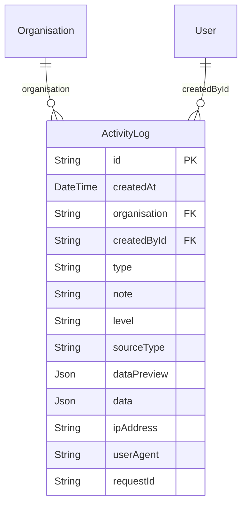

# Auditoría

## `ActivityLog`

Auditoría. Se conserva 24 meses.

| Columna | Tipo | Obligatoria | Por defecto | Descripción |
|---|---|---|---|---|
| `id` | texto | sí | cuid | Clave primaria. Identificador |
| `createdAt` | fecha y hora | sí | ahora | Cuándo se creó |
| `organisation` | texto | sí |  | Proyecto → `Organisation` (se borra con él) |
| `createdById` | texto | sí |  | Usuario que lo creó → `User` |
| `type` | texto | sí |  | P.ej. "assessment-evaluation.complete" |
| `note` | texto | sí |  | Texto del registro |
| `level` | texto | sí | "INFO" | INFO / WARNING / ERROR / DEBUG |
| `sourceType` | texto | sí | "UI" | Origen de la acción |
| `dataPreview` | JSON | sí |  | Resumen del detalle |
| `data` | JSON | sí |  | Detalle de la acción |
| `ipAddress` | texto | no |  | IP |
| `userAgent` | texto | no |  | Navegador |
| `requestId` | texto | no |  | Petición, para cruzar con los registros |

Índices: `(organisation, type, createdAt)`; `(organisation, level, createdAt)`; `(createdAt)`.
