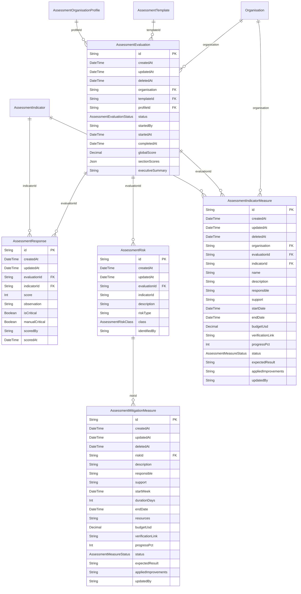

# Evaluaciones y planes

## `AssessmentEvaluation`

Aplicación de una herramienta a una organización.

| Columna | Tipo | Obligatoria | Por defecto | Descripción |
|---|---|---|---|---|
| `id` | texto | sí | cuid | Clave primaria. Identificador |
| `createdAt` | fecha y hora | sí | ahora | Cuándo se creó |
| `updatedAt` | fecha y hora | sí |  | Último cambio |
| `deletedAt` | fecha y hora | no |  | Borrado lógico: con fecha, está borrado |
| `organisation` | texto | sí |  | Proyecto dueño del dato → `Organisation` |
| `templateId` | texto | sí |  | Plantilla → `AssessmentTemplate` |
| `profileId` | texto | sí |  | Organización evaluada → `AssessmentOrganisationProfile` |
| `status` | `AssessmentEvaluationStatus` | sí | DRAFT | Estado |
| `startedBy` | texto | sí |  | Quién la inició |
| `startedAt` | fecha y hora | sí | ahora | Cuándo se inició |
| `completedAt` | fecha y hora | no |  | Cuándo se completó |
| `globalScore` | decimal | no |  | Puntaje global, guardado al completar |
| `sectionScores` | JSON | no |  | { [sectionId]: { weightedAvg, critical } } |
| `executiveSummary` | texto | no |  | Narrativa ejecutiva (IA), opcional |

Índices: `(organisation)`; `(profileId)`; `(templateId)`; `(organisation, status, updatedAt)`.

## `AssessmentResponse`

Calificación de un KPI.

| Columna | Tipo | Obligatoria | Por defecto | Descripción |
|---|---|---|---|---|
| `id` | texto | sí | cuid | Clave primaria. Identificador |
| `createdAt` | fecha y hora | sí | ahora | Cuándo se creó |
| `updatedAt` | fecha y hora | sí |  | Último cambio |
| `evaluationId` | texto | sí |  | Evaluación → `AssessmentEvaluation` (se borra con él) |
| `indicatorId` | texto | sí |  | KPI → `AssessmentIndicator` |
| `score` | entero | sí |  | 1..10 entero — validado también en DTO |
| `observation` | texto | sí |  | Observación obligatoria |
| `isCritical` | sí/no | sí | false | Crítico: nota de 5 o menos, o marcado a mano |
| `manualCritical` | sí/no | sí | false | Marcado a mano |
| `scoredBy` | texto | sí |  | Trazabilidad de autoría |
| `scoredAt` | fecha y hora | sí | ahora | Cuándo se calificó |

Único: `(evaluationId, indicatorId)`.
Índices: `(evaluationId)`; `(evaluationId, isCritical)`.

## `AssessmentRisk`

Riesgo identificado al calificar un KPI en Riesgos.

| Columna | Tipo | Obligatoria | Por defecto | Descripción |
|---|---|---|---|---|
| `id` | texto | sí | cuid | Clave primaria. Identificador |
| `createdAt` | fecha y hora | sí | ahora | Cuándo se creó |
| `updatedAt` | fecha y hora | sí |  | Último cambio |
| `evaluationId` | texto | sí |  | Evaluación → `AssessmentEvaluation` (se borra con él) |
| `indicatorId` | texto | sí |  | KPI |
| `description` | texto | sí |  | Riesgo identificado (obligatorio) |
| `riskType` | texto | no |  | Tipo de riesgo |
| `class` | `AssessmentRiskClass` | sí |  | Calculado automáticamente según riskThreshold |
| `identifiedBy` | texto | sí |  | Quién lo identificó |

Único: `(evaluationId, indicatorId)`.
Índices: `(evaluationId)`.

## `AssessmentMitigationMeasure`

Medida del plan de mitigación (Riesgos).

| Columna | Tipo | Obligatoria | Por defecto | Descripción |
|---|---|---|---|---|
| `id` | texto | sí | cuid | Clave primaria. Identificador |
| `createdAt` | fecha y hora | sí | ahora | Cuándo se creó |
| `updatedAt` | fecha y hora | sí |  | Último cambio |
| `deletedAt` | fecha y hora | no |  | Borrado lógico: con fecha, está borrado |
| `riskId` | texto | sí |  | Riesgo → `AssessmentRisk` (se borra con él) |
| `description` | texto | sí |  | Descripción |
| `responsible` | texto | sí |  | Responsable asignado (obligatorio) |
| `support` | texto | no |  | "apoyo" — persona/rol de soporte al responsable |
| `startWeek` | fecha y hora | sí |  | Lunes de la semana de inicio (selector) |
| `durationDays` | entero | sí |  | Duración estimada |
| `endDate` | fecha y hora | sí |  | Calculada: startWeek + durationDays (servicio) |
| `resources` | texto | no |  | Recursos |
| `budgetUsd` | decimal | no |  | "inversión ($ USD)" estimada para la medida |
| `verificationLink` | texto | no |  | "medios de verificación" — enlace/evidencia de cumplimiento |
| `progressPct` | entero | sí | 0 | 0..100 |
| `status` | `AssessmentMeasureStatus` | sí | PENDING | Derivado de progressPct |
| `expectedResult` | texto | no |  | Resultado esperado al ejecutar la medida |
| `appliedImprovements` | texto | no |  | Mejoras aplicadas / evidencia narrativa del avance |
| `updatedBy` | texto | sí |  | Quién lo cambió por última vez |

Índices: `(riskId)`.

## `AssessmentIndicatorMeasure`

Medida del plan de acción (Organizativa y Capacidades). La herramienta sale de `evaluation.template.tool`.

| Columna | Tipo | Obligatoria | Por defecto | Descripción |
|---|---|---|---|---|
| `id` | texto | sí | cuid | Clave primaria. Identificador |
| `createdAt` | fecha y hora | sí | ahora | Cuándo se creó |
| `updatedAt` | fecha y hora | sí |  | Último cambio |
| `deletedAt` | fecha y hora | no |  | Borrado lógico: con fecha, está borrado |
| `organisation` | texto | sí |  | Proyecto dueño del dato → `Organisation` |
| `evaluationId` | texto | sí |  | Evaluación → `AssessmentEvaluation` (se borra con él) |
| `indicatorId` | texto | sí |  | KPI → `AssessmentIndicator` |
| `name` | texto | sí |  | Nombre |
| `description` | texto | no |  | Descripción |
| `responsible` | texto | sí |  | Responsable asignado (obligatorio) |
| `support` | texto | no |  | "apoyo" — persona/rol de soporte al responsable |
| `startDate` | fecha y hora | sí |  | Inicio |
| `endDate` | fecha y hora | sí |  | Fin |
| `budgetUsd` | decimal | no |  | "inversión ($ USD)" estimada para la medida |
| `verificationLink` | texto | no |  | "medios de verificación" — enlace/evidencia de cumplimiento |
| `progressPct` | entero | sí | 0 | 0..100 |
| `status` | `AssessmentMeasureStatus` | sí | PENDING | Derivado de progressPct |
| `expectedResult` | texto | no |  | Resultado esperado al ejecutar la medida |
| `appliedImprovements` | texto | no |  | Mejoras aplicadas / evidencia narrativa del avance |
| `updatedBy` | texto | sí |  | Quién lo cambió por última vez |

Índices: `(evaluationId)`; `(indicatorId)`.
