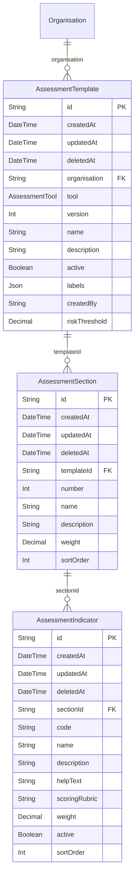

# Herramientas

## `AssessmentTemplate`

Estructura de una herramienta en un proyecto. Cada cambio sobre una versión ya usada crea otra.

| Columna | Tipo | Obligatoria | Por defecto | Descripción |
|---|---|---|---|---|
| `id` | texto | sí | cuid | Clave primaria. Identificador |
| `createdAt` | fecha y hora | sí | ahora | Cuándo se creó |
| `updatedAt` | fecha y hora | sí |  | Último cambio |
| `deletedAt` | fecha y hora | no |  | Borrado lógico: con fecha, está borrado |
| `organisation` | texto | sí |  | Proyecto dueño del dato → `Organisation` |
| `tool` | `AssessmentTool` | sí |  | Herramienta |
| `version` | entero | sí | 1 | Versión, desde 1 |
| `name` | texto | sí |  | Nombre |
| `description` | texto | no |  | Descripción |
| `active` | sí/no | sí | true | Solo una vigente por herramienta y proyecto |
| `labels` | JSON | no |  | Textos en otros idiomas |
| `createdBy` | texto | no |  | Quién lo creó |
| `riskThreshold` | decimal | no | 5 | Umbral por defecto de Riesgos (5) |

Único: `(organisation, tool, version)`.
Índices: `(organisation, tool)`.

## `AssessmentSection`

Dimensión, área o principio, según la herramienta.

| Columna | Tipo | Obligatoria | Por defecto | Descripción |
|---|---|---|---|---|
| `id` | texto | sí | cuid | Clave primaria. Identificador |
| `createdAt` | fecha y hora | sí | ahora | Cuándo se creó |
| `updatedAt` | fecha y hora | sí |  | Último cambio |
| `deletedAt` | fecha y hora | no |  | Borrado lógico: con fecha, está borrado |
| `templateId` | texto | sí |  | Plantilla → `AssessmentTemplate` (se borra con él) |
| `number` | entero | sí |  | Número de la sección |
| `name` | texto | sí |  | Nombre |
| `description` | texto | no |  | Descripción |
| `weight` | decimal | sí | 1 | Peso para el promedio ponderado global |
| `sortOrder` | entero | sí | 0 | Orden |

Único: `(templateId, number)`.
Índices: `(templateId)`.

## `AssessmentIndicator`

KPI.

| Columna | Tipo | Obligatoria | Por defecto | Descripción |
|---|---|---|---|---|
| `id` | texto | sí | cuid | Clave primaria. Identificador |
| `createdAt` | fecha y hora | sí | ahora | Cuándo se creó |
| `updatedAt` | fecha y hora | sí |  | Último cambio |
| `deletedAt` | fecha y hora | no |  | Borrado lógico: con fecha, está borrado |
| `sectionId` | texto | sí |  | Sección → `AssessmentSection` (se borra con él) |
| `code` | texto | sí |  | Por ejemplo `KPI 1.3`. Estable entre versiones |
| `name` | texto | sí |  | Nombre |
| `description` | texto | no |  | Descripción |
| `helpText` | texto | no |  | Qué documento/proceso concreto debe existir para este KPI |
| `scoringRubric` | texto | no |  | Nota específica de este KPI, se muestra junto a la rúbrica genérica 1-10 |
| `weight` | decimal | sí | 1 | Peso del KPI dentro de la sección |
| `active` | sí/no | sí | true | En falso no cuenta en evaluaciones nuevas, pero sigue visible |
| `sortOrder` | entero | sí | 0 | Orden |

Único: `(sectionId, code)`.
Índices: `(sectionId)`.
