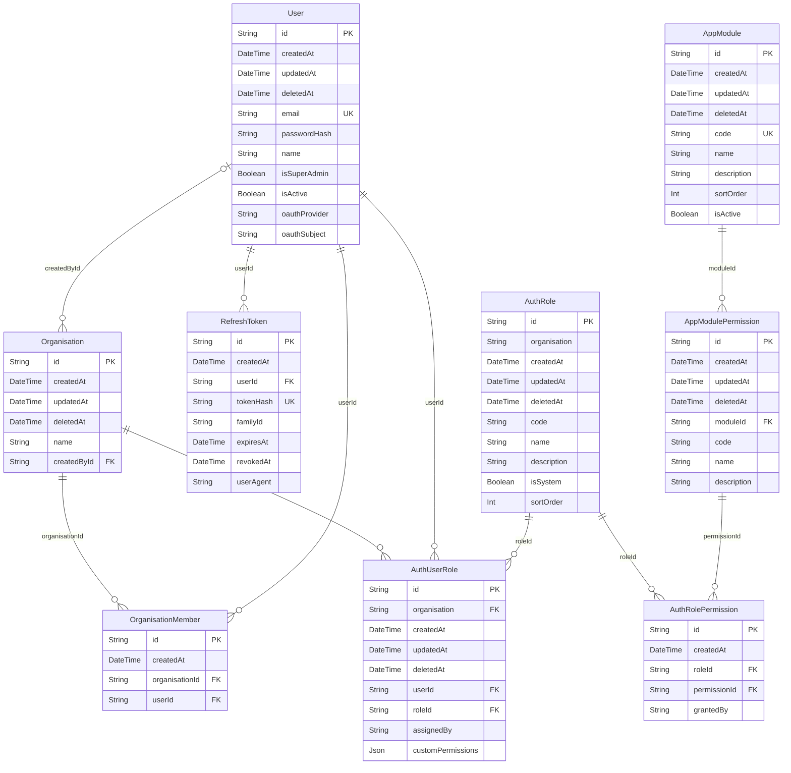

# Identidad y acceso

## `Organisation`

**Proyecto.** Es el inquilino: separa por completo los datos de cada cliente. El `id` es un texto legible que viaja en las direcciones y no cambia.

| Columna | Tipo | Obligatoria | Por defecto | Descripción |
|---|---|---|---|---|
| `id` | texto | sí |  | Clave primaria. Slug legible, p.ej. "demo" — se usa como `:org` en las rutas |
| `createdAt` | fecha y hora | sí | ahora | Cuándo se creó |
| `updatedAt` | fecha y hora | sí |  | Último cambio |
| `deletedAt` | fecha y hora | no |  | Borrado lógico: con fecha, está borrado |
| `name` | texto | sí |  | Nombre |
| `createdById` | texto | no |  | Superadministrador que lo creó: solo él tiene acceso total → `User` (queda nulo si se borra) |

Índices: `(createdById)`.

## `User`

Cuenta de una persona, independiente de los proyectos.

| Columna | Tipo | Obligatoria | Por defecto | Descripción |
|---|---|---|---|---|
| `id` | texto | sí | cuid | Clave primaria. Identificador |
| `createdAt` | fecha y hora | sí | ahora | Cuándo se creó |
| `updatedAt` | fecha y hora | sí |  | Último cambio |
| `deletedAt` | fecha y hora | no |  | Borrado lógico: con fecha, está borrado |
| `email` | texto | sí |  | Correo, en minúsculas. Único |
| `passwordHash` | texto | no |  | Null cuando el usuario solo entra por OAuth |
| `name` | texto | no |  | Nombre |
| `isSuperAdmin` | sí/no | sí | false | Superadministrador de la plataforma |
| `isActive` | sí/no | sí | true | En falso no puede entrar y pierde el acceso al momento |
| `oauthProvider` | texto | no |  | Proveedor externo (google) |
| `oauthSubject` | texto | no |  | Identificador en ese proveedor |

Único: `(oauthProvider, oauthSubject)`.

## `RefreshToken`

Sesiones. Cada renovación revoca el token usado y crea otro de la misma familia.

| Columna | Tipo | Obligatoria | Por defecto | Descripción |
|---|---|---|---|---|
| `id` | texto | sí | cuid | Clave primaria. Identificador |
| `createdAt` | fecha y hora | sí | ahora | Cuándo se creó |
| `userId` | texto | sí |  | Usuario → `User` (se borra con él) |
| `tokenHash` | texto | sí |  | Sha256 del token; el valor real solo está en la cookie. Único |
| `familyId` | texto | sí |  | Cadena de rotaciones de una misma sesión |
| `expiresAt` | fecha y hora | sí |  | Vencimiento |
| `revokedAt` | fecha y hora | no |  | Cuándo se rotó o se revocó |
| `userAgent` | texto | no |  | Navegador |

Índices: `(userId)`; `(familyId)`.

## `OrganisationMember`

A qué proyectos pertenece cada usuario.

| Columna | Tipo | Obligatoria | Por defecto | Descripción |
|---|---|---|---|---|
| `id` | texto | sí | cuid | Clave primaria. Identificador |
| `createdAt` | fecha y hora | sí | ahora | Cuándo se creó |
| `organisationId` | texto | sí |  | Proyecto → `Organisation` (se borra con él) |
| `userId` | texto | sí |  | Usuario → `User` (se borra con él) |

Único: `(organisationId, userId)`.
Índices: `(userId)`.

## `AppModule`

Módulos sobre los que se dan permisos.

| Columna | Tipo | Obligatoria | Por defecto | Descripción |
|---|---|---|---|---|
| `id` | texto | sí | cuid | Clave primaria. Identificador |
| `createdAt` | fecha y hora | sí | ahora | Cuándo se creó |
| `updatedAt` | fecha y hora | sí |  | Último cambio |
| `deletedAt` | fecha y hora | no |  | Borrado lógico: con fecha, está borrado |
| `code` | texto | sí |  | "assessment-core", "organizational-tool", .... Único |
| `name` | texto | sí |  | Nombre |
| `description` | texto | no |  | Descripción |
| `sortOrder` | entero | sí | 0 | Orden |
| `isActive` | sí/no | sí | true | Activo |

Índices: `(code)`.

## `AppModulePermission`

Acciones de cada módulo: read, write, delete, admin.

| Columna | Tipo | Obligatoria | Por defecto | Descripción |
|---|---|---|---|---|
| `id` | texto | sí | cuid | Clave primaria. Identificador |
| `createdAt` | fecha y hora | sí | ahora | Cuándo se creó |
| `updatedAt` | fecha y hora | sí |  | Último cambio |
| `deletedAt` | fecha y hora | no |  | Borrado lógico: con fecha, está borrado |
| `moduleId` | texto | sí |  | Módulo de permisos → `AppModule` |
| `code` | texto | sí |  | "read", "write", "delete", "admin" |
| `name` | texto | sí |  | Nombre |
| `description` | texto | no |  | Descripción |

Único: `(moduleId, code)`.
Índices: `(moduleId)`.

## `AuthRole`

Roles: `assessment_admin`, `assessment_evaluator` y `assessment_viewer`.

| Columna | Tipo | Obligatoria | Por defecto | Descripción |
|---|---|---|---|---|
| `id` | texto | sí | cuid | Clave primaria. Identificador |
| `organisation` | texto | no |  | Nulo en los roles de sistema |
| `createdAt` | fecha y hora | sí | ahora | Cuándo se creó |
| `updatedAt` | fecha y hora | sí |  | Último cambio |
| `deletedAt` | fecha y hora | no |  | Borrado lógico: con fecha, está borrado |
| `code` | texto | sí |  | Código |
| `name` | texto | sí |  | Nombre |
| `description` | texto | no |  | Descripción |
| `isSystem` | sí/no | sí | false | Rol de sistema |
| `sortOrder` | entero | sí | 0 | Orden |

Único: `(organisation, code)`.
Índices: `(organisation)`; `(code)`.

## `AuthRolePermission`

Qué permisos tiene cada rol.

| Columna | Tipo | Obligatoria | Por defecto | Descripción |
|---|---|---|---|---|
| `id` | texto | sí | cuid | Clave primaria. Identificador |
| `createdAt` | fecha y hora | sí | ahora | Cuándo se creó |
| `roleId` | texto | sí |  | Rol → `AuthRole` (se borra con él) |
| `permissionId` | texto | sí |  | Permiso → `AppModulePermission` (se borra con él) |
| `grantedBy` | texto | no |  | Quién lo otorgó |

Único: `(roleId, permissionId)`.
Índices: `(roleId)`; `(permissionId)`.

## `AuthUserRole`

Qué rol tiene cada usuario en cada proyecto.

| Columna | Tipo | Obligatoria | Por defecto | Descripción |
|---|---|---|---|---|
| `id` | texto | sí | cuid | Clave primaria. Identificador |
| `organisation` | texto | sí |  | Proyecto dueño del dato → `Organisation` (se borra con él) |
| `createdAt` | fecha y hora | sí | ahora | Cuándo se creó |
| `updatedAt` | fecha y hora | sí |  | Último cambio |
| `deletedAt` | fecha y hora | no |  | Revocación del rol |
| `userId` | texto | sí |  | Usuario → `User` (se borra con él) |
| `roleId` | texto | sí |  | Rol → `AuthRole` (se borra con él) |
| `assignedBy` | texto | no |  | Quién lo asignó |
| `customPermissions` | JSON | no |  | En el visualizador, qué organizaciones ve: `{ allProfiles, profileIds }` |

Único: `(organisation, userId, roleId)`.
Índices: `(organisation)`; `(userId)`; `(roleId)`.
