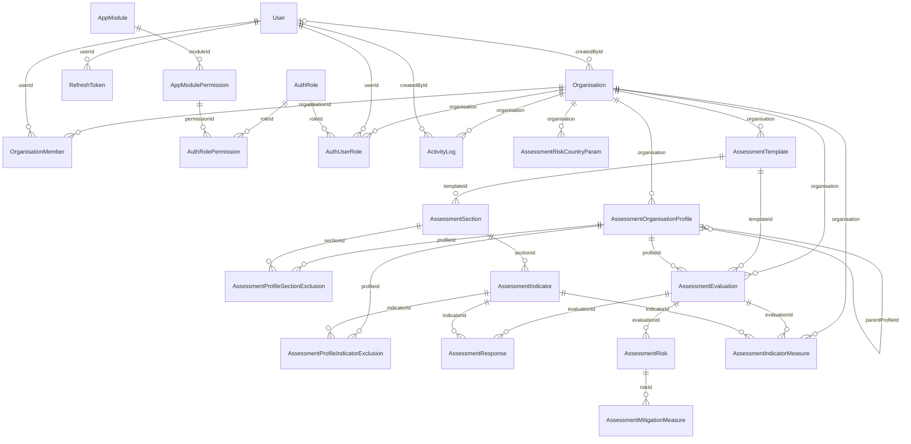

# Base de datos

PostgreSQL con Prisma 5. El modelo está en `prisma/schema.prisma` y tiene 23 tablas.

## Diagrama

## Convenciones

- **Inquilino.** Los datos de evaluación llevan `organisation`, el proyecto dueño.
  Toda consulta filtra por él.
- **Claves.** `cuid` como texto, salvo `Organisation` (un texto legible) y
  `AssessmentAiCache` (un sha256).
- **Borrado lógico.** `deletedAt` con fecha significa borrado. No hay un filtro
  automático: cada consulta agrega `deletedAt: null`.
- **Fechas de calendario** (inicio y fin de medidas): medianoche UTC. La web toma
  solo año, mes y día.
- **Decimales.** Pesos y puntajes son `Decimal`; la API los entrega como texto.
- **Nombres únicos con borrado lógico.** Los índices únicos no excluyen los
  borrados: por eso se revive la fila con `upsert` en lugar de crear otra.

## Enumeraciones

| Enumeración | Valores |
|---|---|
| `AssessmentTool` | `ORGANIZATIONAL`, `CAPACITY`, `RISK` |
| `AssessmentEvaluationStatus` | `DRAFT`, `IN_PROGRESS`, `COMPLETED`, `ARCHIVED` |
| `AssessmentRiskClass` | `NEGLIGIBLE`, `NON_NEGLIGIBLE` |
| `AssessmentMeasureStatus` | `PENDING`, `IN_PROGRESS`, `DONE` |

## Tablas

| Grupo | Tablas |
|---|---|
| [Identidad y acceso](identidad-y-acceso.md) | `Organisation`, `User`, `RefreshToken`, `OrganisationMember`, `AppModule`, `AppModulePermission`, `AuthRole`, `AuthRolePermission`, `AuthUserRole` |
| [Auditoría](auditoria.md) | `ActivityLog` |
| [Organizaciones evaluadas](organizaciones-evaluadas.md) | `AssessmentOrganisationProfile`, `AssessmentProfileSectionExclusion`, `AssessmentProfileIndicatorExclusion`, `AssessmentRiskCountryParam` |
| [Herramientas](herramientas.md) | `AssessmentTemplate`, `AssessmentSection`, `AssessmentIndicator` |
| [Evaluaciones y planes](evaluaciones-y-planes.md) | `AssessmentEvaluation`, `AssessmentResponse`, `AssessmentRisk`, `AssessmentMitigationMeasure`, `AssessmentIndicatorMeasure` |
| [Inteligencia artificial](inteligencia-artificial.md) | `AssessmentAiCache` |

Las migraciones, los datos iniciales y consultas útiles están en
[migraciones](migraciones.md).
