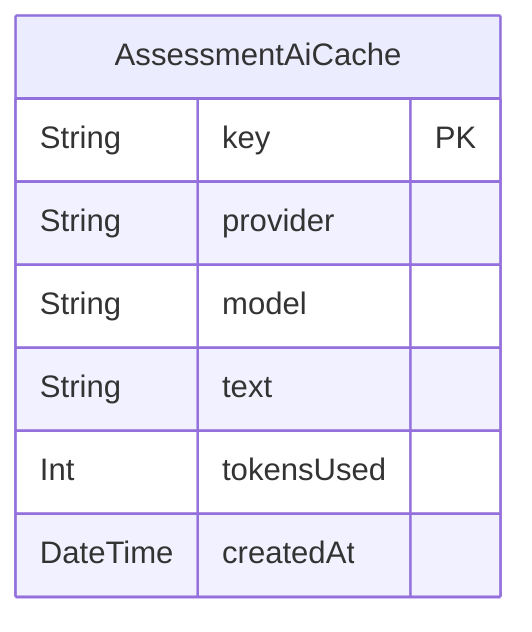

# Inteligencia artificial

## `AssessmentAiCache`

Respuestas de la IA reutilizables. Se purgan a los 90 días. No se relaciona con nada.

| Columna | Tipo | Obligatoria | Por defecto | Descripción |
|---|---|---|---|---|
| `key` | texto | sí |  | Clave primaria. Sha256 de proveedor + modelo + prompts + límite |
| `provider` | texto | sí |  | Proveedor |
| `model` | texto | no |  | Modelo |
| `text` | texto | sí |  | Respuesta guardada |
| `tokensUsed` | entero | no |  | Tokens que costó |
| `createdAt` | fecha y hora | sí | ahora | Cuándo se creó |

Índices: `(createdAt)`.
