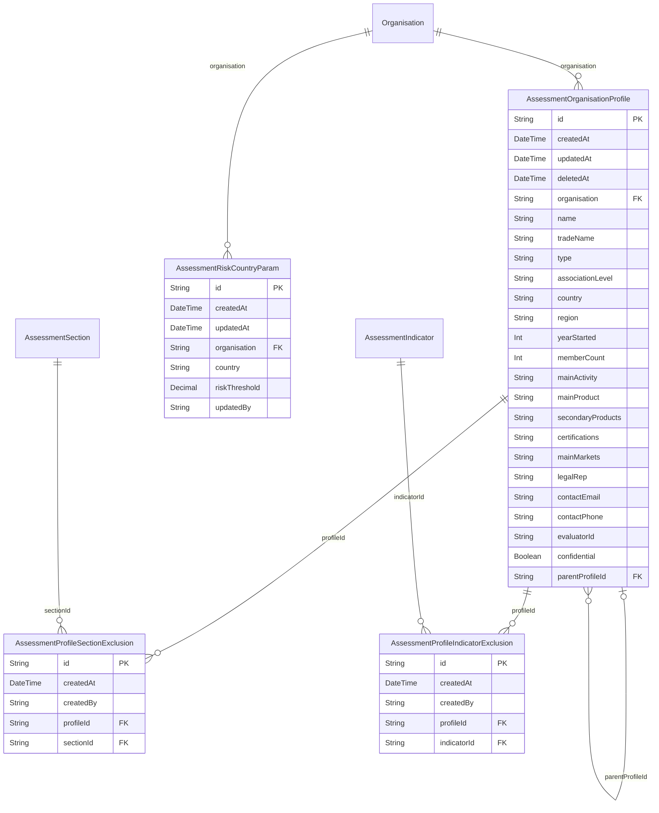

# Organizaciones evaluadas

## `AssessmentOrganisationProfile`

**Organización evaluada**: una asociación o una empresa. El nombre es único en el proyecto.

| Columna | Tipo | Obligatoria | Por defecto | Descripción |
|---|---|---|---|---|
| `id` | texto | sí | cuid | Clave primaria. Identificador |
| `createdAt` | fecha y hora | sí | ahora | Cuándo se creó |
| `updatedAt` | fecha y hora | sí |  | Último cambio |
| `deletedAt` | fecha y hora | no |  | Borrado lógico: con fecha, está borrado |
| `organisation` | texto | sí |  | Organización dueña del dato → `Organisation` |
| `name` | texto | sí |  | Nombre |
| `tradeName` | texto | no |  | Nombre comercial |
| `type` | texto | sí |  | "ASSOCIATION" / "COMPANY" |
| `associationLevel` | texto | no |  | LEVEL_1 o LEVEL_2, solo en asociaciones |
| `country` | texto | sí |  | Determina parámetros de riesgo en Risk |
| `region` | texto | no |  | Región o provincia |
| `yearStarted` | entero | no |  | Año de inicio de actividades |
| `memberCount` | entero | no |  | Número de socios |
| `mainActivity` | texto | no |  | Actividad principal (p.ej. "Exportación de cacao...") |
| `mainProduct` | texto | sí |  | "cacao" / "café" / otro |
| `secondaryProducts` | texto | no |  | Otros productos (opcional) |
| `certifications` | texto | no |  | Certificaciones |
| `mainMarkets` | texto | no |  | Principales mercados |
| `legalRep` | texto | no |  | Representante legal |
| `contactEmail` | texto | no |  | Correo de contacto |
| `contactPhone` | texto | no |  | `+prefijo número`, con los dígitos de su país |
| `evaluatorId` | texto | no |  | Evaluador responsable asignado |
| `confidential` | sí/no | sí | false | Excluye este perfil de la vista cross-organización del Administrador |
| `parentProfileId` | texto | no |  | Asociación de nivel 2 a la que pertenece → `AssessmentOrganisationProfile` |

Único: `(organisation, name)`.
Índices: `(organisation)`; `(evaluatorId)`; `(parentProfileId)`.

## `AssessmentProfileSectionExclusion`

Secciones que no aplican a una organización.

| Columna | Tipo | Obligatoria | Por defecto | Descripción |
|---|---|---|---|---|
| `id` | texto | sí | cuid | Clave primaria. Identificador |
| `createdAt` | fecha y hora | sí | ahora | Cuándo se creó |
| `createdBy` | texto | sí |  | Quién lo creó |
| `profileId` | texto | sí |  | Organización evaluada → `AssessmentOrganisationProfile` (se borra con él) |
| `sectionId` | texto | sí |  | Sección → `AssessmentSection` (se borra con él) |

Único: `(profileId, sectionId)`.
Índices: `(profileId)`.

## `AssessmentProfileIndicatorExclusion`

KPI que no aplican a una organización.

| Columna | Tipo | Obligatoria | Por defecto | Descripción |
|---|---|---|---|---|
| `id` | texto | sí | cuid | Clave primaria. Identificador |
| `createdAt` | fecha y hora | sí | ahora | Cuándo se creó |
| `createdBy` | texto | sí |  | Quién lo creó |
| `profileId` | texto | sí |  | Organización evaluada → `AssessmentOrganisationProfile` (se borra con él) |
| `indicatorId` | texto | sí |  | KPI → `AssessmentIndicator` (se borra con él) |

Único: `(profileId, indicatorId)`.
Índices: `(profileId)`.

## `AssessmentRiskCountryParam`

Umbral de riesgo despreciable por país.

| Columna | Tipo | Obligatoria | Por defecto | Descripción |
|---|---|---|---|---|
| `id` | texto | sí | cuid | Clave primaria. Identificador |
| `createdAt` | fecha y hora | sí | ahora | Cuándo se creó |
| `updatedAt` | fecha y hora | sí |  | Último cambio |
| `organisation` | texto | sí |  | Proyecto dueño del dato → `Organisation` |
| `country` | texto | sí |  | ISO 3166-1 alpha-2, p.ej. "EC" |
| `riskThreshold` | decimal | sí |  | Umbral de ese país |
| `updatedBy` | texto | no |  | Quién lo cambió por última vez |

Único: `(organisation, country)`.
