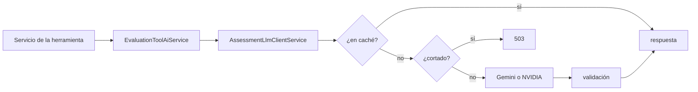

# Inteligencia artificial y reportes

## Cómo funciona la IA

| Pieza | Archivo |
|---|---|
| Elección del proveedor | `assessment-ai/infrastructure/ai-provider.factory.ts` |
| Llamada, caché y tiempo límite | `assessment-ai/application/assessment-llm-client.service.ts` |
| Corte por fallos | `assessment-ai/domain/llm-circuit-breaker.ts` |
| Instrucciones | `evaluation-tool/application/evaluation-tool-ai.service.ts` |
| Lectura y validación | `evaluation-tool/domain/evaluation-tool-ai.types.ts` |

| Capacidad | Modelo | Caché | Qué recibe |
|---|---|---|---|
| Mejorar observación | Normal | No | Solo ese KPI |
| Sugerir medidas | Normal | No | KPI críticos de una sección |
| Detectar contradicciones | Normal | No | Notas y observaciones recortadas |
| Narrativa ejecutiva | Rápido | No | Puntajes y críticos |
| Análisis del reporte | Rápido | 90 días | Puntajes, mejores y peores KPI |
| FODA | Rápido | 90 días | Puntajes y nombres. Solo evaluaciones completadas |

Reglas:

- **Sin inventar.** La instrucción exige usar solo los datos enviados y todo id que no
  se envió se descarta. Los textos son un borrador que la persona revisa.
- **Coste.** Una llamada por tarea, sin historial y con el contexto mínimo. La clave de
  caché es un sha256 del proveedor, el modelo, las instrucciones y el límite: repetir
  un reporte no cuesta nada y cambiar una nota genera otro.
- **Tiempo.** 25 s por llamada (Heroku corta a los 30) y 8 s en total para el reporte.
- **Fallos.** Cinco seguidos cortan al proveedor 5 minutos. Una respuesta ilegible se
  reintenta una vez y nunca se guarda.
- **Sin clave**, la IA responde 503 y lo demás funciona.

| Variable | Para qué |
|---|---|
| `AI_PROVIDER` | `gemini` o `nvidia` |
| `GEMINI_API_KEY`, `NVIDIA_API_KEY` | Credenciales |
| `GEMINI_MODEL`, `NVIDIA_MODEL` | Modelo normal |
| `GEMINI_FAST_MODEL` | Modelo rápido |

## Reportes

| Formato | Constructor |
|---|---|
| PowerPoint de Organizativa y Capacidades | `evaluation-tool/infrastructure/reports/evaluation-report.builders.ts` |
| PowerPoint y Excel de Riesgos | `risk-tool/infrastructure/reports/risk-report.builders.ts` |
| Excel del panel | `assessment-core/infrastructure/assessment-dashboard-export.service.ts` |
| Láminas | `shared/infrastructure/reports/pptx-report.util.ts` |
| Hojas de cálculo | `shared/infrastructure/reports/excel-cell.util.ts` |
| Cupo | `shared/infrastructure/reports/export-limiter.ts` |

Orden de la presentación: portada, resumen ejecutivo, resultados globales, lectura
ejecutiva, una lámina por sección, hallazgos, KPI críticos, plan y cronograma,
evolución, FODA y recomendaciones.

- El color de cada herramienta está en su definición (`report.accentColor`). El
  semáforo se reserva para los niveles.
- Todo son formas nativas: se ve igual en PowerPoint, Keynote y Google Slides.
- Las tablas se parten por la altura estimada de las filas.
- El cronograma abarca la herramienta, la organización o el proyecto. En los dos
  últimos hay una barra por grupo, no por medida.
- Sin IA, las fortalezas, brechas y lecturas salen de los datos.
- Se generan 2 a la vez (`EXPORT_MAX_CONCURRENCY`) y esperan hasta 20
  (`EXPORT_MAX_QUEUED`).
