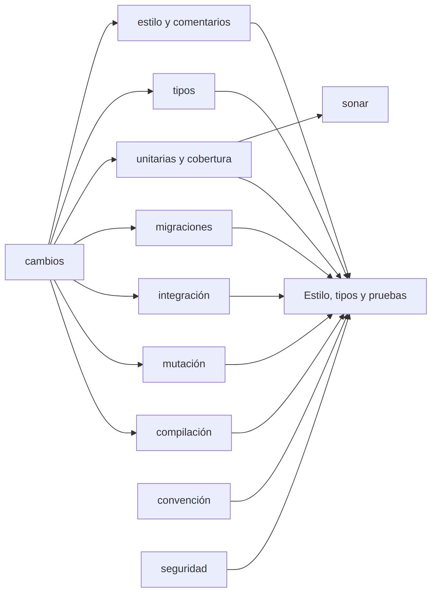

# Pruebas y pipeline

## Pruebas

| Tipo | Dónde | Comando |
|---|---|---|
| Unitarias | `*.spec.ts` junto al código | `npm test` |
| Integración | `test/*.e2e-spec.ts`, contra PostgreSQL con seed | `npm run test:e2e` |
| Mutación | `stryker.config.json` | `npm run test:mutation` |
| Carga | `scripts/carga-guardado.mjs` | [rendimiento.md](rendimiento.md) |

| Prueba de integración | Cubre |
|---|---|
| `auth-session` | Sesión, rotación, pestañas y límites |
| `security-routes` | Todas las rutas cerradas, toma de cuentas, pérdida inmediata de acceso |
| `project-access` | Proyectos, superadministradores y visualizadores |
| `organisation-management`, `user-management` | Proyectos y usuarios |
| `assessment-profiles` | Organizaciones evaluadas |
| `organizational-tool-flow`, `capacity-risk-flow` | Flujo completo de las herramientas |
| `measures-and-exports` | Medidas, PowerPoint y Excel |
| `admin-config` | Estructura y parámetros |
| `assessment-analytics` | Analítica |

Cobertura mínima: 44 % sentencias, 40 % ramas y funciones, 45 % líneas. Solo puede subir.

Mutación: cambia el código a propósito y mide si alguna prueba lo nota.

| Módulo | Mínimo |
|---|---|
| `puntaje` | 70 % |
| `acceso` | 90 % |
| `ia` | 65 % |

## Pipeline

| Workflow | Cuándo | Qué hace |
|---|---|---|
| `ci.yml` | Pull request y push a `develop` y `main` | Todas las etapas. La última es la que exige la protección de ramas |
| `codeql.yml` | Pull request, push y semanal | Análisis de código |
| `despliegue.yml` | Al terminar el CI de `main` | Espera a Heroku y verifica salud, acceso y CORS |
| `vigilancia.yml` | Cada 15 minutos | Comprueba producción y abre un aviso si falla |

- **cambios** salta las pruebas si solo cambió documentación.
- **convención**: título y commits con Conventional Commits.
- **seguridad**: falla si se agregan vulnerabilidades altas o críticas.
- **migraciones**: se aplican desde cero y deben coincidir con el esquema.
- **sonar**: se activa con `SONAR_ORGANIZATION` y `SONAR_TOKEN`.
- Un push nuevo cancela el CI anterior del pull request, pero nunca el de `develop` o
  `main`.
- El último trabajo acepta etapas omitidas, no fallidas ni canceladas.

Las pruebas no usan secretos: generan su clave y levantan su propia base.
